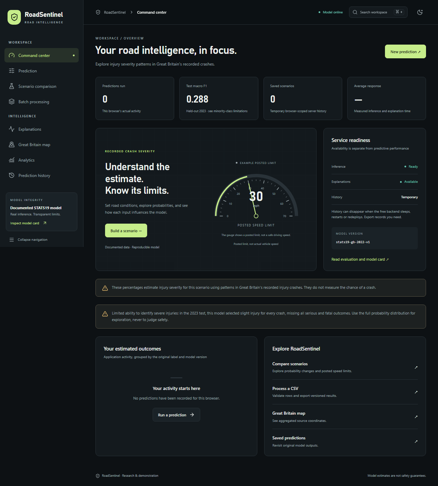
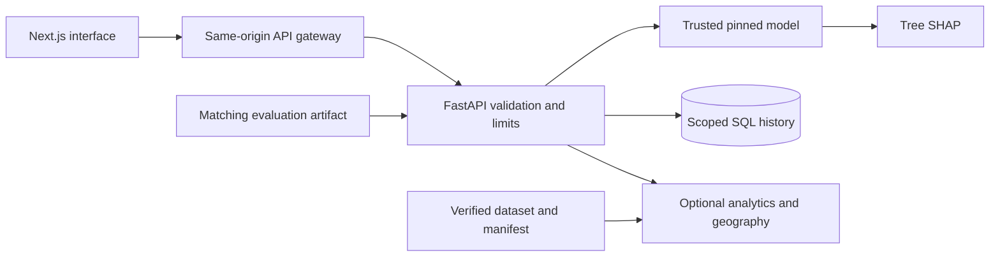

# RoadSentinel

Source repository: [Shouktick/RoadSentinel](https://github.com/Shouktick/RoadSentinel).

AI road accident model intelligence with real Random Forest inference, Tree SHAP explanations, scenario comparison, CSV processing, and transparent evidence limits.

> The original training dataset and codebook are unavailable. Numeric class IDs are displayed without assigning unverified severity meanings. Speed units, held-out performance, India coverage, and severity-weighted risk remain unverified. No synthetic accident records or evaluation scores are presented as real.

## Screenshots

The application uses a responsive automotive instrument-panel design, an SVG speed-limit gauge, light/dark themes, and keyboard navigation. These screenshots were captured from the actual local application during passing desktop/mobile browser checks.



[Mobile command center screenshot](docs/screenshots/command-center-mobile.png)

## Implemented features

- Actual probability inference from the original pinned Random Forest artifact; heuristic prediction removed.
- Local multiclass Tree SHAP, signed contributors, expected-value/additivity checks, and simple/technical explanation language.
- Validated seven-feature scenario forms, hypothetical presets, explicit save, copy summary, input-sharing URL, and JSON export.
- What-If probability comparison and genuine speed-limit sweeps. Risk-reduction search is gated on verified severity semantics.
- CSV preview, column mapping, bounded uploads/rows, actual upload progress, row errors, preserved input columns, sorting/filtering/pagination, and formula-safe result export.
- SQL-backed, session-scoped saved history, details, search, filtering, sorting, export, and deletion.
- Real backend/model readiness and actual per-session application activity; unavailable metrics remain explicit.
- Dataset/coordinate provenance gates and adapters for future verified analytics, global SHAP, and geographic observations.
- Ten primary routes, responsive navigation, command palette, themes, onboarding, error/404 states, and installation metadata.

## Current limitations

No actual dataset analytics, observed accident map, global/dependence SHAP results, held-out metrics, retrained model comparison, verified severity label mapping, or canonical speed conversion can be claimed without reviewed source material. The map supports source observation markers when configured; a geographic density heat layer is not implemented. Lighthouse targets are not achieved merely by building successfully. There is no offline prediction support.

History is server-side, not local mock data. Local SQLite persists across restarts; free hosting disks can be ephemeral. Set `HISTORY_DURABLE=true` only with confirmed persistent storage or PostgreSQL. Browser session access is a random bearer token, not account authentication. Clearing local storage loses access; use an account identity system for production multi-device use.

## Stack and architecture

Next.js App Router, React, strict TypeScript, Tailwind, TanStack Query, Zod, React Hook Form, Framer Motion, and dynamically loaded Leaflet. FastAPI, Pydantic, scikit-learn 1.8.0, pandas/NumPy, SHAP, SQLAlchemy, SQLite/PostgreSQL.



```text
frontend/src/app/                  Routes and API gateway
frontend/src/components/platform/ UI, forms, charts, history, model card
frontend/src/lib/                  Runtime schemas, API, units, sharing
frontend/e2e/                     Browser journeys
backend/app/{core,schemas,database,services}/
backend/app/main.py                API factory and routes
backend/main.py                    Existing provider-compatible entry point
backend/model_metadata.json        Fingerprints and evidence status
backend/scripts/train.py           Future reviewed-data evaluation workflow
backend/tests/                     Actual model/API and test-only fixture checks
docs/                              Audit, design, model, API, architecture, progress
docker-compose.yml                 Local frontend/backend and persistent volume
render.yaml                        Optional free backend setup blueprint
```

## Local setup

Use Python 3.12 and Node.js 22. No secrets are required for local inference.

```powershell
python -m venv .venv
.venv\Scripts\Activate.ps1
pip install -r backend/requirements-dev.txt
cd backend
uvicorn main:app --reload
```

In another terminal:

```powershell
cd frontend
npm ci
# Create frontend/.env.local with NEXT_PUBLIC_API_URL=http://localhost:8000
npm run dev
```

Open `http://localhost:3000`. Backend interactive documentation: `http://localhost:8000/docs`. Python environment and model initialization can take time on first start. The original ZIP is retained; checksums are verified before its trusted pickle is loaded. Never replace it with an untrusted pickle.

## Environment variables

- `NEXT_PUBLIC_API_URL`: backend root URL. Used centrally by the same-origin server gateway. A temporary fallback to existing `NEXT_PUBLIC_BACKEND_URL` preserves provider configuration during migration. There is no production localhost fallback.
- `DATABASE_URL`: SQLite URL locally, or `postgresql+psycopg://...` for managed PostgreSQL. Keep credentials in provider environment settings.
- `HISTORY_DURABLE`: defaults false. Set true only after storage persistence is verified.
- `CORS_ORIGINS`: exact comma-separated origins for direct browser clients. Same-origin gateway requests do not require broad CORS.
- `SHAP_ENABLED`: defaults true; failed/unavailable explanations are explicit.
- `MODEL_ARCHIVE`, `MODEL_MANIFEST`: optional trusted versioned model/metadata locations; hashes and feature/runtime agreement are mandatory.
- `METRICS_PATH`: actual matching held-out metrics artifact; absent by default.
- `DATASET_PATH`, `DATASET_MANIFEST`: optional reviewed dataset and source/fingerprint manifest. Not configured for the unavailable original data.

See `.env.example`. No API keys or credentials should be committed.

## Tests and quality checks

```powershell
.venv\Scripts\python.exe -m pytest backend/tests -q
.venv\Scripts\ruff.exe check backend/app backend/tests backend/scripts
cd frontend
npm run lint
npm run typecheck
npm run test
npm run format:check
npm run build
npx playwright install chromium
npm run test:e2e
```

Browser tests start the actual API and production frontend. Test fixture datasets are explicitly synthetic and never exposed as product observations or evaluation. See `docs/PROGRESS.md` for checks actually run and remaining verification limits.

## Docker

```sh
docker compose up --build
```

Frontend: port 3000; backend: port 8000. The named `history` volume persists local database records. The API uses one worker to avoid multiplying model/explainer memory. Inspect `/health` and test a prediction after startup. This configuration requires a running Docker daemon.

## API

See [docs/API.md](docs/API.md) and backend `/docs`. Routes have `/api/v1` aliases. Class probabilities use 0-1, not the legacy heuristic percentage scale. `GET /health` separates loaded class inference from verified severity readiness.

## Model and training

The legacy artifact identifies RandomForestClassifier, 200 estimators, seven ordered inputs, and scikit-learn 1.8.0. Its training provenance remains unknown. See [docs/MODEL_CARD.md](docs/MODEL_CARD.md).

For a future licensed/reviewed dataset with canonical `Slight`, `Serious`, `Fatal` target labels and verified speed units:

```sh
python backend/scripts/train.py /path/real.csv /path/reviewed-manifest.json /path/new-artifact-directory
```

The script fingerprints input, separates train/validation/test (time/group-aware when declared), compares RF and histogram gradient boosting on validation macro F1, and evaluates the selected fit on held-out test rows. It does not overwrite the original artifact. No new training/evaluation has been performed without data. Additional cross-validation/calibration and external validity review are required before high-stakes use.

## Vercel frontend deployment

Connect this GitHub repository with root directory `frontend`, framework Next.js, install `npm ci`, build `npm run build`, Node 22. Set `NEXT_PUBLIC_API_URL` to the HTTPS backend root. The existing legacy variable is accepted during migration. Deploy the tested commit and verify `/api/service/health`, prediction, local explanations, and failure states. Never assume a successful Git push means deployment succeeded.

## Render / Railway backend deployment

Retain the existing repository integration, or use `render.yaml` to configure a new free service explicitly. Root `backend`, Python 3.12.13, install `pip install -r requirements.txt`, start `uvicorn main:app --host 0.0.0.0 --port $PORT --workers 1`, health `/health`. Railway can use the backend Dockerfile with the platform port configured, or the same Python start command. Set managed PostgreSQL or a persistent volume for durable history; free local disks do not establish durability. No paid resource is provisioned by this repository change.

The frontend distinguishes backend waking/unavailable from success. Confirm the deployed model version, predictions and SHAP before announcing release. Store provider credentials outside Git. The example blueprint does not alter an existing service's dashboard configuration by itself.

## Documentation

[Audit](docs/AUDIT.md) · [Design](docs/DESIGN.md) · [Model card](docs/MODEL_CARD.md) · [API](docs/API.md) · [Architecture](docs/ARCHITECTURE.md) · [Implementation record](docs/PROGRESS.md) ? [Standalone deployment](docs/DEPLOYMENT.md).

## Disclaimer

Research and demonstration only. Outputs explain a fitted model, not real-time accident risk, causal effects, or guarantees of safety. Do not use this unverified model for emergency response, enforcement, insurance, or individual driving decisions.
