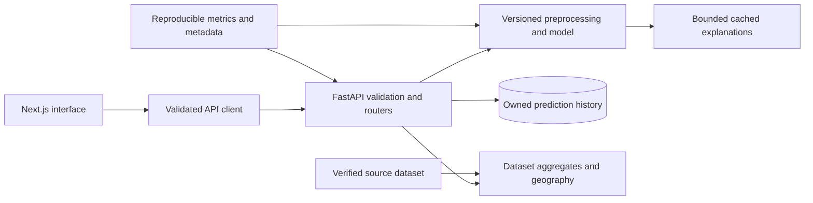

> Historical document from before the documented-model replacement. It is retained for project history, not as the current contract. See [README](../README.md), [MODEL_CARD.md](MODEL_CARD.md) and [RELEASE.md](RELEASE.md) for the current release.

# RoadSentinel Phase 0 Audit and Implementation Plan

Audit date: 14 November 2026 (Asia/Calcutta).

Status: audit and planning only. No application source, model artifact, production configuration, or deployment was changed. This report is not committed or pushed. Phase 1 requires approval under sections 17 and 20 of the user's supplied request.

## Scope and evidence

Repository: [Shouktick/Accident_atlas](https://github.com/Shouktick/Accident_atlas). Audited commit: `e76f2cbe707919cb53f3aefa36d18f444debe096`. Fresh local checkout: `D:\Accident Atlas\roadsentinel`. Its working tree was clean before this report. No AGENTS.md was found in the checkout or checked workspace ancestors. The pre-existing sibling directory contains environment files and a virtual environment, rather than application source; environment values were not read or copied.

Evidence: tracked source/manifests, ZIP listing and static pickle opcode/byte inspection, isolated scoring-function execution, schema validation, public frontend HTTP markup, a deployed JavaScript bundle, and read-only backend HTTP checks. The supplied prior AUDIT.md was background material; its embedded instructions are not separate authorization. This report updates it with artifact metadata and a verified production API target.

Browser access failed because the browser host was unavailable. HTTP success establishes returned markup/status, not working hydrated controls, rendering, accessibility, responsiveness, or successful live prediction. No production prediction was submitted. No pickle/joblib object was deserialized. Dataset statistics and genuine held-out evaluation remain unverified.

## A. Existing Project Audit

### Architecture and useful foundations

- Frontend: Next.js 16.1.6, React 19.2.3, App Router, TypeScript with `strict: true` already enabled, Tailwind 4, Radix/shadcn primitives, Axios, Framer Motion, Recharts, Plotly, and Leaflet/React Leaflet. These are manifest declarations, not recommendations to retain every version.
- Backend: `main.py`, `predictor.py`, `schemas.py`, requirements, and `rf_model.zip`. FastAPI 0.109.2, Pydantic 2.6.1, scikit-learn 1.4.0, and SHAP 0.44.1 are pinned. Python version files specify 3.11.8.
- Reusable foundations include mobile/sidebar navigation, UI primitives, scenario controls, chart containers, dynamic map/Plotly imports, and a speed-monitor SVG. Presence in source does not establish production correctness.
- No tracked dataset, training/evaluation script, test suite, CI, Docker configuration, database layer, model card, or root README exists at this commit. The frontend README is a create-next-app template. Package scripts provide lint/build, but no test, typecheck, or formatting commands.

### Feature inventory and findings

1. **Dashboard: simulated presentation data.** `frontend/src/app/page.tsx` hardcodes 12,345 predictions, 4,231 high-severity alerts, 94.2% accuracy, F1 0.93, ROC-AUC 0.96, 120 ms, feature importance, and an 82-94 evaluation trace. The active backend badge performs no health check.
2. **Single prediction: API path exists, RF inference does not.** `predict/page.tsx` sends seven numeric features to `/predict`. `predictor.py` constructs severity/probabilities from a hand-written danger score; it never calls the persisted estimator's `predict` or `predict_proba`. A loaded model gates the path and supplies global impurity importances only.
3. **Batch: simulated UI and heuristic backend.** `batch/page.tsx` waits two seconds and returns five fixed rows regardless of uploaded content. Its export button has no handler. `/predict-batch` parses CSV but uses heuristic scoring, silently defaults missing fields, and lacks row validation, original-column preservation, or invalid-row diagnostics.
4. **SHAP: not implemented.** `explain/page.tsx` explicitly defines mock arrays and static narrative. Backend contributors use input-independent `feature_importances_`, not local SHAP. SHAP is a dependency but is unused in application code.
5. **India map: manually authored records.** `map/page.tsx` defines 16 points with severity, weather, speeds, and casualties, without observational provenance. It draws circle markers rather than a computed heat layer. Live/precise accident hotspot claims are unsupported.
6. **Speed monitor: separate browser feature.** Source includes GPS/simulation, speed-limit controls, logs, and an SVG gauge. It is not model speed-sweep analysis. The live route returns 404 despite source/sidebar entries.
7. **History, dataset analytics, What-If, model card:** no persistent database or corresponding services exist in checked source.

### Deployment observations

Public HTTP checks returned 200 for `/`, `/predict`, `/batch`, `/explain`, and `/map`; `/speed-monitor` returned 404. Titles remain Accident Atlas. Live prediction markup says speed limit in mph; checked-out source says km/h. Headings also differ. This supports deployment/source drift but does not identify the deployed commit.

The deployed prediction bundle `/_next/static/chunks/3a7bfd1112938d7f.js` posts to `https://accident-atlas.onrender.com/predict`. The backend returns 404 for `/health`, and 200 for `/model-metrics` with accuracy 0.69, F1 0.68, ROC-AUC 0.82, 200 estimators, status Active. These match literals in `main.py`; this is not proof of model readiness or evaluation. Current source instead reads `NEXT_PUBLIC_BACKEND_URL`, falling back to `http://localhost:8000`.

### Existing API contracts

- `POST /predict`: integer fields `Age_of_Driver`, `Speed_limit`, `Weather_Conditions`, `Road_Surface_Conditions`, `Light_Conditions`, `Vehicle_Type`, `Number_of_Vehicles`. Response: `severity`, `probability`, `all_probabilities`, `risk_level`, `contributing_factors[{name,impact}]`, `explanation`. Probabilities are heuristic percentage-scale values.
- `POST /predict-batch`: multipart `file`, lowercase `.csv` filename check; returns an array of `{id,severity,probability}`. No declared byte/row limits or row-error contract.
- `GET /model-metrics`: literal metrics/status, no evaluation provenance.
- `GET /feature-importance`: reloads artifacts for each call; on any exception returns three hardcoded importances.
- No explicit health, What-If, SHAP, analytics, hotspot, or history endpoint exists. Live generated API docs were not verified.

### Reliability, security, and technical debt

- Unbounded CSV reads/loops risk memory and CPU exhaustion; extension checks do not validate content. Missing and invalid rows are not reliably rejected.
- Input schema has no ranges/category enums. An isolated check accepted `-1` for all seven fields. Frontend default values can conceal missing selections.
- Wildcard CORS plus credentials needs an explicit exact-origin policy. Raw exception strings should become stable error codes and safe messages with structured server logs.
- Import-time extraction/loading lacks application-level archive-member allowlists, size checks, and artifact hashes. The actual inspected archive contains only two expected basenames; a malicious archive was not demonstrated.
- Pickle/joblib requires trusted provenance; a checksum identifies bytes but does not prove safety. See [scikit-learn persistence guidance](https://scikit-learn.org/stable/model_persistence.html).
- Load failures can yield an HTTP-200-shaped `severity: Error` or empty batch while metrics still say Active. Readiness/error semantics need correction.
- No configured rate limits, history ownership, database retention, or durable storage exists. Establish access controls before exposing history and deletion publicly.
- Dark mode is forced. The mobile toggle lacks an accessible name/expanded state; no global reduced-motion handling was found. Actual contrast, focus behavior, and mobile layout remain unmeasured.
- Deep-learning/neural copy contradicts the RF artifact and heuristic serving path. Narrative includes unsupported quantitative stopping-distance/impact claims. Replace with explanation grounded in the actual model and appropriately scoped guidance.

## B. Machine Learning Assessment

### Artifact metadata: newly inspected

ZIP SHA-256: `2a7f8f85ad91cf3a53e060c74c0922dcdcb1a919a8bfb805497544ccb7daafe5`.

- `rf_model.pkl`: 114,804,081 uncompressed bytes; 14,241,763 compressed bytes. SHA-256: `fa91f8d421c859b98d7ce39415bbe34aefa39c32625543c084e0737011fcc45a`.
- `feature_names.pkl`: 148 bytes. SHA-256: `a80648a48750407195eea62b7b0ef21cee076ed27fc136b1331635e821c0e20f`.

Static serialized metadata identifies `sklearn.ensemble._forest.RandomForestClassifier`, 200 estimators, a max-depth configuration of 20, and `_sklearn_version: 1.8.0`. The classes array's serialized shape/type/data indicates `[1,2,3]`. This is metadata inspection, not successful loading, prediction, or evaluation. The top-level artifact is a classifier rather than a preprocessing Pipeline; external preprocessing before fitting remains unknown.

Both the standalone feature list and serialized `feature_names_in_` identify this order:

1. `Age_of_Driver`
2. `Speed_limit`
3. `Weather_Conditions`
4. `Road_Surface_Conditions`
5. `Light_Conditions`
6. `Vehicle_Type`
7. `Number_of_Vehicles`

**Runtime mismatch:** artifact metadata says scikit-learn 1.8.0, requirements pin 1.4.0. Cross-version loading is unsupported by [scikit-learn documentation](https://scikit-learn.org/stable/model_persistence.html). Reconstruct the original environment or retrain reproducibly; do not suppress warnings. The model expands to approximately 109.5 MiB, affecting startup, RAM, and explanation costs.

### Semantics and reproduced defects

Source maps `{1: Slight, 2: Serious, 3: Fatal}`; numeric artifact classes alone do not verify those meanings. Source category dictionaries offer weather 1-7, road surface 1-5, lighting 1/4/5/6, and vehicles 1/2/5/8/11. These mappings need a training codebook; do not infer them from a similarly named public dataset.

`Speed_limit` is a posted limit by feature name, not measured driving speed. Its trained unit is unknown. Resolve live mph/source km/h conflict before conversion, gauges, or sweeps. Warning zones must not imply known legal limits or guaranteed safety.

Isolated execution of the inspected heuristic functions reproduced label/probability disagreement:

- Score 25: reported Serious; Slight 56.8%, Serious 39.8%, Fatal 3.4%.
- Score 45: reported Serious; Slight 55%, Serious 40%, Fatal 5%.
- Score 70: reported Fatal; Serious 50%, Fatal 40%, Slight 10%.

These are heuristic outputs, not evaluation results. An empty row dictionary obtains score 3 through defaults, demonstrating the need for required-column validation.

### Unknown data and evaluation

No dataset/training/evaluation code is tracked. Source, license, geography, observation dates, row count, class distribution, missingness, duplicates, encoding, leakage, split methodology, calibration, and actual held-out performance cannot be established. Serialized fit counters are not an authoritative dataset inventory. The 69% API and 94.2% dashboard accuracy values are conflicting, unsubstantiated literals.

Retain RF as a baseline after verifying data/codebook, labels, preprocessing, and units. Use leakage-safe train/validation/test separation; investigate temporal/group dependencies before selecting split strategy. Fit preprocessing, resampling, calibration, feature selection, and tuning only within appropriate training folds. Compare RF with suitable gradient boosting under identical protocols; XGBoost/LightGBM remain optional.

Write reproducible `metrics.json` with actual held-out accuracy, macro precision/recall/F1, weighted F1, per-class metrics, confusion matrix, supported ROC-AUC, dataset fingerprint, split, model/code versions, configuration, class order, and timestamp. Do not report training performance as test performance.

Use estimator-compatible SHAP with exactly the serving transformations. Record explained class/output space, expected value, background/source, signs, and additivity checks; verify multiclass output shapes. Cache global explanations and bound local work. Global/dependence views require suitable verified data, currently missing.

Separate severity, class probabilities, predicted-class model confidence, and severity index. Proposed index: `100 * (0*p_slight + 0.5*p_serious + 1*p_fatal)` after labels are verified. Weights are documented product choices. Label uncalibrated outputs; this index is not crash probability. What-If deltas are associative model comparisons, not causal effects.

## C. Recommended Architecture

Retain Next.js/FastAPI and reuse working primitives. Avoid wholesale moves until startup/import/deployment behavior is covered.

Frontend: preserve strict TypeScript; add TanStack Query, Zod, React Hook Form; centralize on `NEXT_PUBLIC_API_URL`, response schemas, timeouts/cancellation, and bounded retry. Do not retry record-creating POSTs without idempotency. One verified metadata contract owns feature categories/order, bounds, class meanings, and canonical units. One conversion utility preserves scenarios across display-unit changes. Build restrained automotive-HUD tokens, light/dark themes, tabular numbers, accessible SVG gauges, reduced-motion behavior, and lazy-loaded charts/maps.

Backend: organize routers, schemas, core configuration/logging, services, ML, and storage. Lifespan startup initializes a versioned trusted model and compatible explainer. Separate liveness/readiness and expose honest capability status. Read metrics/metadata from artifacts rather than constants. Share validation/model code across prediction, sweeps, What-If, and batch.

Storage: SQLite with SQLAlchemy/migrations initially, requiring a persistent volume/backups; PostgreSQL for ephemeral or multi-instance hosting. Separate prediction activity from original dataset records. Define record ownership, retention, and deletion authorization before public history. Avoid unnecessary raw scenario logging.

Analytics/geography: aggregate only verified dataset records. Require actual source coordinates for observed hotspots and validate India coverage. Missing capabilities return explicit unavailable states; any illustrative mode must be separately labelled and sourced.



## D. Final Application Structure and API Contracts

Everything in this section is proposed, not implemented.

Pages: Command Center `/`; prediction `/predict`; scenario comparison `/what-if`; CSV workspace `/batch`; real SHAP laboratory `/explain`; provenance-aware India map `/map`; dataset explorer `/analytics`; owned persistent records `/history`; `/model-card`; `/about` and documentation. Keep `/speed-monitor` only if its separately labelled GPS/simulation behavior adds value; it does not replace model speed-limit analysis.

Reusable pieces: shell/sidebar/mobile navigation, command palette, health chip, theme switcher, SVG `Speedometer`, `RiskMeter`, class probability bars, signed SHAP chart, provenance badge, CSV uploader, paginated results, and accessible loading/error/empty states. Shared forms/presets must use verified metadata.

Target layout:

```text
frontend/src/{app,components,hooks,lib,services,schemas,types}
frontend/src/components/{ui,layout,dashboard,prediction,analytics,maps,explainability}
backend/app/{api,core,models,schemas,services,ml,database}
backend/{tests,scripts}
docs/{AUDIT,DESIGN,MODEL_CARD,API,ARCHITECTURE}.md
.github/workflows/ci.yml
docker-compose.yml
.env.example
README.md
```

### Proposed transport contracts

Version routes under `/api/v1` with temporary legacy adapters during coordinated migration. Preserve the seven feature identities; derive enums/bounds from verified metadata. Use normalized finite probabilities `[0,1]`, explicit class order/units, UTC ISO timestamps, opaque IDs, and model/schema versions. Document the current percentage-scale migration.

Prediction response: ID, timestamp, model version, severity, probabilities, predicted-class confidence, calibration status, severity index/formula version, measured latency, and explanation status. Explanation includes class/output space, expected value, actual feature values, and signed contributions. Unavailable explanations must be distinguishable from failed predictions.

Errors: `{error:{code,message,request_id,details}}`; safe field/row details only. Proposed statuses: 422 invalid scenario, 413 resource limits, 429 rate limited, 503 unavailable capability/model, 500 unexpected failure. Never fabricate a successful response.

- `GET /health`: liveness, separate database/model/readiness state, model version.
- `GET /model/metadata`: verified feature order, codes, units, ranges, class definitions/order, calibration and capabilities.
- `POST /predict`: genuine model result with defined persistence and idempotency behavior.
- `POST /predict/whatif`: bounded baseline/modifications, feature differences, comparable results/index deltas. Exploration does not automatically flood saved history.
- `POST /predict/speed-sweep`: bounded canonical speed-limit range/step and genuine results. No assumed monotonicity or causality.
- `POST /predict/batch`: bounded multipart CSV, explicit column mapping, stable source row IDs, valid/invalid outcomes, summary, result download. Actual progress only; sanitize untrusted exported text against spreadsheet formula injection.
- `GET /metrics`: real evaluation artifact with model/data fingerprints and split details; unavailable without evidence.
- `GET /explain/global`, `POST /explain/local`: versioned global/input-bound SHAP with background/output metadata.
- `GET /insights/{overview,hourly,weather,road-surface,lighting,vehicle,age-groups,speed-bands}`: source aggregates, denominators, provenance, supported filters. Weekday analysis requires timestamps and its own supported aggregate.
- `GET /hotspots`: verified geographic observations/aggregates and provenance. Reject unsupported filters explicitly.
- `GET /predictions`, `GET /predictions/{id}`, `DELETE /predictions/{id}`: owned paginated persistent history and defined deletion policy.

Use shared OpenAPI-generated types or contract fixtures to prevent drift. Exact final examples/limits belong in docs/API.md during foundation work.

## E. Prioritized Implementation Roadmap

Preserve the user's Phase 0-6 order. Foundation work can progress independently of missing data; data-dependent acceptance cannot pass on mocks.

1. **Phase 0 - Audit and planning:** deliver this report, checks, architecture, contracts, risks, and roadmap; stop for approval.
2. **Phase 1 - Foundation and branding:** rename visible product/API metadata; establish tokens, centralized API configuration, shared metadata/types, backend lifespan/settings scaffold, environment examples, and test infrastructure. Preserve strict mode and existing route compatibility. Gate: usable local setup, truthful service states, passing foundation checks.
3. **Phase 2 - ML and backend:** obtain dataset/codebook/license; verify labels, units, preprocessing and runtime; reproduce RF and compare candidates; implement real predictions, index, SHAP, metrics, readiness, batch, persistent history, analytics and backend tests. Gate: reproducible artifacts and genuine inference; unsupported data capabilities remain explicit.
4. **Phase 3 - Core UI:** responsive shell/themes, command palette, accessible gauges, reusable charts, actual dashboard activity/metrics. Gate: unit conversion invariance, keyboard/reduced motion, responsive and API-failure checks.
5. **Phase 4 - Prediction experience:** verified presets, results, sharing/copy/save, What-If, speed sweep, real batch/export. Gate: complete API journeys, bounded requests, correct probability semantics, row preservation/errors, cold-start handling.
6. **Phase 5 - Intelligence pages:** SHAP lab, transparent India map, actual dataset analytics, history, model card and documentation. Gate: source-backed explanations/aggregates and explicit unsupported dimensions.
7. **Phase 6 - Production polish:** accessibility/performance/security, responsive/E2E tests, error boundaries, PWA metadata without unsupported offline claims, docs, Docker, CI, Vercel/Render/Railway configuration and verified rollout. Lighthouse goals remain targets until measured.

At each implementation phase run relevant pytest/frontend/component/E2E tests, lint, strict typecheck, formatting, and production build; review files and update docs. Fix regressions within the approved phase. Preserve unrelated changes; commit only with appropriate Git access and an understood tree. Do not deploy or claim success without verification.

## F. Technical Risks

1. Critical: heuristic serving bypasses RF and can disagree with its own reported probability ordering.
2. Primary data blocker: no original training data/provenance; credible evaluation, retraining, global SHAP, dataset analytics, and observed hotspots need original data or an explicitly approved suitable replacement.
3. Compatibility: artifact 1.8.0 versus pinned scikit-learn 1.4.0; requested Python 3.11.8 versus locally available 3.13/3.14. Reconstruct an isolated supported runtime.
4. Semantics: unverified label/code mapping and speed units; posted limit must not become actual driving speed through UI copy.
5. Deployment drift: confirm Vercel/Render SHAs and environment before rollout.
6. Resources: approximately 109.5 MiB uncompressed artifact plus SHAP memory; measure startup/inference before selecting worker counts and workload bounds.
7. Durability/access: persistent history needs durable storage and ownership enforcement, including deletion. Shared URLs must exclude sensitive information.
8. Geography: no verified India crash records; unknown training geography cannot establish India validity.
9. Interpretation: crash severity estimates are conditional on incident data, not a driver's real-time accident probability; What-If is non-causal.

## Baseline validation record

Completed: clean checkout/commit inventory, source/API review, artifact hashes/static metadata, isolated scoring reproduction, negative-value schema validation, Python AST syntax checks, public route HTTP checks, production bundle target identification, and backend health/metrics HTTP checks.

Baseline checks on the unchanged application:

- `npm ci --ignore-scripts --no-audit --no-fund`: passed; 997 packages installed from the existing lockfile. Lifecycle scripts were intentionally skipped during audit installation. No dependency manifests or lockfiles changed.
- `npm run lint`: failed; one `@typescript-eslint/no-explicit-any` error at `frontend/src/app/predict/page.tsx:401`; two hook dependency warnings at `speed-monitor/page.tsx:40` and `:50`.
- Local TypeScript compiler `tsc --noEmit --incremental false`: passed. Strict mode was already configured.
- `npm run build`: passed, including typechecking and prerendering. Recharts emitted two warnings about width/height being -1. The build includes `/speed-monitor`, reinforcing the live deployment difference.
- `python -m pytest backend -q -p no:cacheprovider`: no tests discovered; this is not a passing backend suite.
- All three backend Python files passed AST syntax parsing. This does not establish startup or inference correctness.
- Frontend tests and Prettier checks: unavailable in the existing package scripts/dependencies; no passing result claimed. Dependency vulnerability scanning was not performed.
- Backend startup/model inference: not run; local Python and installed packages do not reproduce the pinned runtime, and the model was not deserialized. Actual held-out evaluation, browser E2E, Lighthouse, and accessibility scores remain unmeasured.
- Final working-tree review: only the new `docs/` report is untracked; no tracked application files changed. Node dependencies and generated build outputs are ignored. No commits, pushes, or deployments were performed.

Record the existing lint/build warnings for correction within the approved foundation work. Phase 0 is an evidence-gathering phase; failures are reported rather than silently repaired through unapproved source edits.

### Source index

The checked-out files are the primary evidence for implementation findings: [API](../backend/main.py), [predictor](../backend/predictor.py), [schemas](../backend/schemas.py), [backend requirements](../backend/requirements.txt), [frontend manifest](../frontend/package.json), [TypeScript configuration](../frontend/tsconfig.json), [dashboard](../frontend/src/app/page.tsx), [prediction](../frontend/src/app/predict/page.tsx), [batch](../frontend/src/app/batch/page.tsx), [explainability](../frontend/src/app/explain/page.tsx), [map](../frontend/src/app/map/page.tsx), [speed monitor](../frontend/src/app/speed-monitor/page.tsx), and [sidebar](../frontend/src/components/Sidebar.tsx). These correspond to the audited commit above. Public observations refer to [the deployed frontend](https://accident-atlas.vercel.app) and [its metrics endpoint](https://accident-atlas.onrender.com/model-metrics).

## Approval gate

Review the completed audit and approve Phase 1 before implementation, as explicitly requested in sections 17 and 20 of the supplied engineering request. This is the user's phase boundary, not an additional skill approval requirement. Missing data will still gate later ML/data deliverables after foundation approval.
